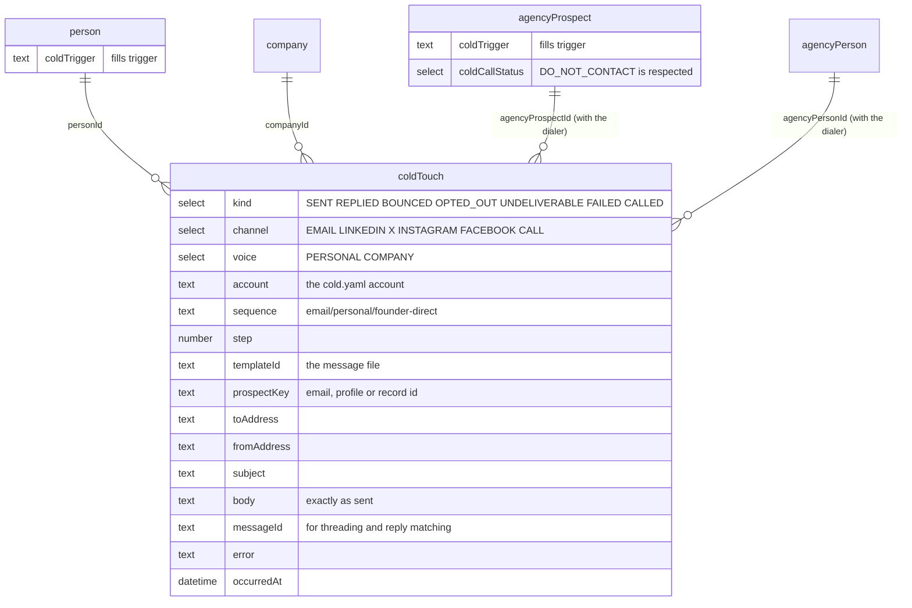

# cold

**Cold call scripts, cold DMs and cold emails for your personal and company
accounts: open source, written to be sent, with every touch kept in
[Twenty CRM](https://twenty.com).**

Built by [Matthew](https://github.com/matthewdonsemail-lab)
([@matthewsoldit on X](https://x.com/matthewsoldit)). It is the messaging half
of [dialer](https://github.com/matthewdonsemail-lab/dialer): the same Twenty
workspace, the same prospects, the same Do Not Contact list.

[](LICENSE)
[](https://bun.sh)
[](https://twenty.com)

Pick a sequence, point it at a list, and `cold` works out who is due for which
step today. It writes each message with the prospect's details, sends the
emails from your own mailbox, and lines up the DMs for you to send. It stops
for anyone who replied, bounced or asked to be left alone, and logs every
touch on the prospect's record in Twenty. Every message comes in two voices:
**personal**, sent from your own name and profiles, and **company**, sent from
the brand or a rep.

## Why it works

- **The messages are the product.** 45 messages across cold email, LinkedIn,
  X, Instagram and Facebook DMs, and call scripts, plus 11 objection answers. Every
  channel is covered twice, once as you and once as the company. Each message
  is a plain Markdown file you can read on GitHub and edit like any other text.
- **Nothing reads like a template.** Every message is built around one line
  only you can write: why this person, why now (`{{trigger}}`). Without it the
  message is held back, not sent with a blank. The other lines (who you help,
  what you do, the proof) are written once per offer and checked to read
  naturally in every sentence that uses them.
- **It stops when it should.** A reply, a bounce or an opt-out ends the
  sequence, and a reply on any channel stops everything automatic for 90 days:
  a reply is a conversation, yours to carry on. An opt-out on any channel stops
  every channel. A dialer prospect marked Do Not Contact is never emailed or
  messaged, and an email unsubscribe marks them Do Not Contact in the dialer
  too. Out-of-office replies and delivery delays change nothing.
- **Email that lands.** Plain text from your own mailbox with no tracking
  pixel. Follow-ups reply in the same thread and quote it, and fall due on
  calendar days in your timezone. There is a daily cap, a sending window checked
  before every email, and a random gap between sends. Every email carries a
  postal address and an opt-out, with `List-Unsubscribe` set.
- **Never the same email twice.** One address gets one message per run, even
  when two prospects share it. If a sent email cannot be logged, the run stops
  and the touch is kept locally, then saved to Twenty before the next run plans
  anything.
- **DMs that keep your account.** LinkedIn, X and Instagram restrict accounts
  that send DMs from scripts, so `cold` never does. It writes the next DM due,
  copies it, opens the profile, and logs what happened when you say. It keeps
  a daily cap per platform.
- **Calls in the dialer.** One command writes the call scripts and objection
  answers into the dialer's `agencyScripts`, so they sit next to every live
  call. For a handset, `cold call sheet` prints one filled in for a prospect.
- **It tells you what works.** `cold stats` shows the reply rate of every
  message and every sequence, so you keep the winners and rewrite the rest.
- **Checked like code.** `bun run check` type-checks, runs the tests (including
  a real SMTP round trip) and lints every message: variables, lengths,
  subjects, emojis, and placeholders that must never reach a prospect.

## The library

| | Personal (sent as you) | Company (sent as the brand or a rep) |
|---|---|---|
| **Email** | `founder-direct` (4 steps), `video-first` (3), `right-person` (2) | `problem-proof` (4), `trigger-event` (3), `video-walkthrough` (3), `right-person` (2) |
| **LinkedIn** | connection note, after accept, video offer, leave it | connection note, after accept, leave it (from a rep's profile) |
| **X** | opener, bump | opener, bump (brand account) |
| **Instagram** | opener, bump | opener, bump (brand account) |
| **Facebook** | opener, bump | none: a Page cannot message first |
| **Calls** | founder direct, warm follow-up, voicemail | reason for the call, gatekeeper, callback, voicemail |
| **Objections** | 11, answered as "I" | the same 11, answered as "we" |

Every file, the template syntax, the variables and the lint rules are
described in [messages/README.md](messages/README.md). To read any of it with
real data:

```bash
bun run cold preview founder-direct --source csv:examples/prospects.csv --prospect "Shine Detail"
```

## Run your own in five commands

You need [Bun](https://bun.sh). Twenty is optional: without it the touch log is
a local file.

```bash
git clone https://github.com/matthewdonsemail-lab/cold.git && cd cold
bun install
cp cold.example.yaml cold.yaml && cp .env.example .env.local   # who sends, the offer, mailbox URLs, Twenty key
bun run twenty:schema                                           # optional: the coldTouch object in Twenty
bun run cold email run founder-direct --source csv:examples/prospects.csv --dry-run
```

- `cold.yaml` holds your accounts (a `personal` one and a `company` one) and
  your offers, meaning who you help, what you do, the outcome, the pain and
  one true sentence of proof. `cold.example.yaml` explains every line.
- `.env.local` holds secrets only: one SMTP and IMAP URL per mailbox, the
  Twenty key, and an optional Reacher URL.
- `twenty:schema` is additive and safe to re-run, like the dialer's. It
  creates the `coldTouch` object and a `coldTrigger` field on people, and links
  touches to the dialer's prospects when they exist. `bun run
  twenty:schema:check` is the dry run.
- Drop `--dry-run` to send. Nothing sends until `cold.yaml` exists and you
  confirm the batch.

## A day with it

```bash
# Morning: emails due today, from your own mailbox (it reads replies first)
bun run cold email run founder-direct --source twenty:people --where 'jobTitle[ilike]:"%owner%"'

# The company sequence to the dialer's prospects, from the company mailbox
bun run cold email run problem-proof --source twenty:agencyProspects --where 'coldCallStatus[eq]:NEW'

# LinkedIn: write, copy, open, send by hand, log
bun run cold dm run dm/personal/linkedin --source twenty:agencyPeople

# Call block: today's scripts into the dialer, then dial
bun run cold call sync --account company --campaign "Austin tint"

# Friday: what got replies
bun run cold stats --days 30
```

Sources are a CSV (`csv:file.csv`), Twenty people (`twenty:people`), or the
dialer's prospects and the people at them (`twenty:agencyProspects`,
`twenty:agencyPeople`). `--where` takes a Twenty filter.

## Personal or company

The same prospect can get either. What changes is who it comes from.

| | Personal | Company |
|---|---|---|
| From | your mailbox, your LinkedIn, your X | the company mailbox or a rep, brand accounts |
| Written as | "I", signed with your first name | "we", with name, title and company |
| Best for | founder-led sales, warm-ish markets | a team, a rep, more than one person can send |
| Proof | your story | customers and numbers |

`cold` refuses to send a sequence in the other account's voice, so a "we" email
never goes out from your personal mailbox by accident. A company LinkedIn page
cannot start a conversation, so company LinkedIn DMs go from a rep's own
profile, in the company voice.

## How a run works

```mermaid
flowchart TB
    src["Prospects<br/>CSV, Twenty people,<br/>dialer prospects"]
    lib["The message library<br/>messages/*.md, linted"]
    cfg["cold.yaml<br/>account + offer"]

    plan{"Who is due?<br/>step N on day N"}
    stop["Skipped<br/>replied, opted out, bounced,<br/>Do Not Contact, finished,<br/>another sequence running"]
    render["Write each message<br/>held back if a variable is empty"]
    guard["Guards<br/>voice, footer, daily cap,<br/>sending window, confirm"]

    email["Email<br/>SMTP from your mailbox,<br/>threaded, plain text"]
    dm["DM<br/>copied and opened,<br/>you send it"]
    call["Calls<br/>scripts in the dialer"]

    log[("Twenty<br/>coldTouches on the person,<br/>company or dialer prospect")]
    sync["cold email sync<br/>IMAP: replies, opt-outs, bounces"]

    src --> plan
    cfg --> plan
    lib --> plan
    plan -->|"not due"| stop
    plan -->|"due"| render --> guard
    guard --> email --> log
    guard --> dm --> log
    lib --> call
    sync --> log
    log -->|"history"| plan

    classDef store fill:#eef2ff,stroke:#4f46e5,color:#1e1b4b
    classDef skip fill:#fffbeb,stroke:#d97706,color:#451a03
    class log store
    class stop skip
```

## Works with the dialer

Run both against one Twenty workspace and they share everything:

- **Call scripts.** `cold call sync` writes every call script for an account
  into `agencyScripts` in the dialer's own format (`content`, `category`,
  `objection_responses`), named with its voice ("Voicemail (personal)",
  "Voicemail (company)"). Scripts are matched per dial campaign, so
  `--campaign` gets its own copy. Prospect details stay as `{{first_name}}` and
  `{{company}}` for the rep to read off the contact.
- **Do Not Contact, both ways.** A prospect set to Do Not Contact in the dialer
  (or opted out of SMS) is never emailed or messaged. An email opt-out sets
  them to Do Not Contact in the dialer.
- **The same records.** `twenty:agencyProspects` reads the dialer's businesses,
  including their decision maker, rating, review count and the walkthrough
  video (`videoUrl` fills `{{video_url}}`). `twenty:agencyPeople` reads the
  people at them, with their LinkedIn and X profiles.
- **One timeline.** Every touch links to the prospect, so the contact page shows
  the calls from the dialer and the emails and DMs from `cold` together.

## The open-source stack

| Project | License | What it does here |
|---|---|---|
| [Twenty](https://github.com/twentyhq/twenty) | AGPLv3 | The CRM and system of record: prospects, people, and every touch |
| [dialer](https://github.com/matthewdonsemail-lab/dialer) | MIT | The power dialer the call scripts sync into |
| [Nodemailer](https://github.com/nodemailer/nodemailer) | MIT-0 | Sends each email over SMTP, from your own mailbox |
| [ImapFlow](https://github.com/postalsys/imapflow) and [mailparser](https://github.com/nodemailer/mailparser) | MIT | Read the inbox for replies, opt-outs and bounces |
| [Reacher](https://github.com/reacherhq/check-if-email-exists) | MIT | Optional, self-hosted: checks an address exists before the first email |
| [Cal.com](https://github.com/calcom/cal.com) | MIT | Your booking link (`{{booking_url}}`) |
| [Cap](https://github.com/CapSoftware/Cap) | AGPLv3 | Records the personal videos the video sequences send (`{{video_url}}`) |
| [Bun](https://bun.sh) | MIT | Runs it, tests it, loads `.env.local` |

`cold` talks to Twenty over its API and includes none of its code.

## Data model



One append-only log is the whole state: what was sent, what came back, who
asked to be left alone. There is no database of its own. The event field is
`kind` because `event` is a reserved name in Twenty. Without Twenty, the same
records go to `.cold/touches.jsonl`.

## Commands

| Command | What it does |
|---|---|
| `cold list` | Every sequence and script, with when to use it |
| `cold lint` | Check every message; exits 1 on an error |
| `cold variables` | The variables a message can use |
| `cold preview <id>` | Read a message, sequence or script filled in, with example or real prospect data |
| `cold twenty:schema` | Create `coldTouch` and its fields in Twenty (`--dry-run` to check) |
| `cold email run <sequence>` | Send the steps due today (`--dry-run` first) |
| `cold email sync` | Log replies, opt-outs and bounces from the inbox |
| `cold email verify` | Check addresses with Reacher (`--record` suppresses invalid ones) |
| `cold dm run <sequence>` | Work through today's DMs, or `--export` a checklist for a VA |
| `cold call sync` | Write the call scripts into the dialer |
| `cold call sheet <script>` | Print a call script and every objection answer |
| `cold stats` | Reply rate per message and per sequence |
| `cold log <prospect>` | Log a touch by hand (a reply on the phone, an opt-out) |

`bun run cold help` lists every flag. Ids shorten to any unique ending:
`founder-direct`, `call/company/gatekeeper`.

## Rules it enforces

- A message with an empty variable is held back, never sent with a gap.
- A sequence only goes out from an account in its own voice.
- Every email has a postal address and an opt-out line, or nothing sends.
- Subjects never start with "Re:" or "Fwd:" unless the email really is a reply.
- No emojis, and no `[placeholder]` in anything written.
- One sequence per channel per prospect at a time, with 30 days between them.
- Nobody who replied anywhere in the last 90 days is sent anything automatic.
- One address gets one message per run.
- Daily caps per mailbox and per DM platform, and a sending window in your
  timezone, checked before every email.
- Only a recipient's server refusing the address counts as a bounce. A refused
  sender (a sending limit, bad credentials) stops the run instead, and a
  delivery delay is ignored.
- A send that cannot be logged stops the run, and is saved before the next one
  plans anything.
- The example config can preview but never send, or write scripts into the
  dialer.

The legal side (CAN-SPAM, GDPR and PECR, CASL, calling rules, platform terms) is
in [docs/compliance.md](docs/compliance.md). How to run the sequences well
(domains, warm-up, volumes, writing triggers) is in
[docs/playbook.md](docs/playbook.md).

## Configuration

| Where | What |
|---|---|
| `cold.yaml` | Accounts (voice, sender details, mailbox settings, caps, sending window) and offers. Start from `cold.example.yaml`. |
| `.env.local` | `TWENTY_BASE_URL`, `TWENTY_API_KEY`, one `SMTP_URL_*` and `IMAP_URL_*` per mailbox, optional `REACHER_URL` and `REACHER_SECRET`. Start from `.env.example`. |
| `COLD_CONFIG` | Point at a config file somewhere else. |
| `TWENTY_REQUESTS_PER_MINUTE` | Twenty allows 100 a minute per key; `cold` uses 90 unless told otherwise. |

## Repository layout

```
messages/                 the library (see messages/README.md)
src/
  cli.ts                  the cold command
  domains/
    messages/             load and lint the library
    render/               the template syntax and the variable contract
    config/               cold.yaml
    prospects/            CSV and Twenty sources, identities
    touches/              the touch log (Twenty or file) and the sequence planner
    outreach/             variables and rendering per prospect
    email/                build, send, sync replies, verify
    dm/                   the DM queue
    call/                 dialer script sync and call sheets
    stats/                reply rates
    twenty/               the API client and the schema
    cli/                  terminal input and output
docs/                     playbook and compliance
examples/prospects.csv    five fictional prospects
```

The code follows the dialer's layout: camelCase `domains/<domain>/<primitive>`,
pure helpers under `helpers/`, input and output in `index.ts`, tests next to
the code.

## Checks

```bash
bun run check        # typecheck + tests + message lint, what CI runs
bun test             # tests only
bun run lint:messages
```

## License

MIT. See [LICENSE](LICENSE).
