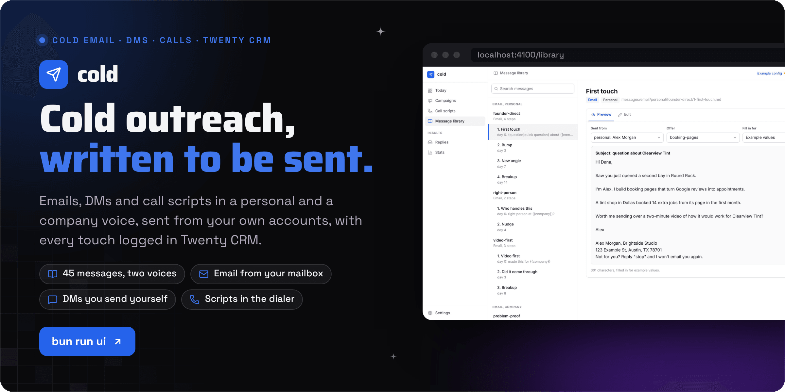
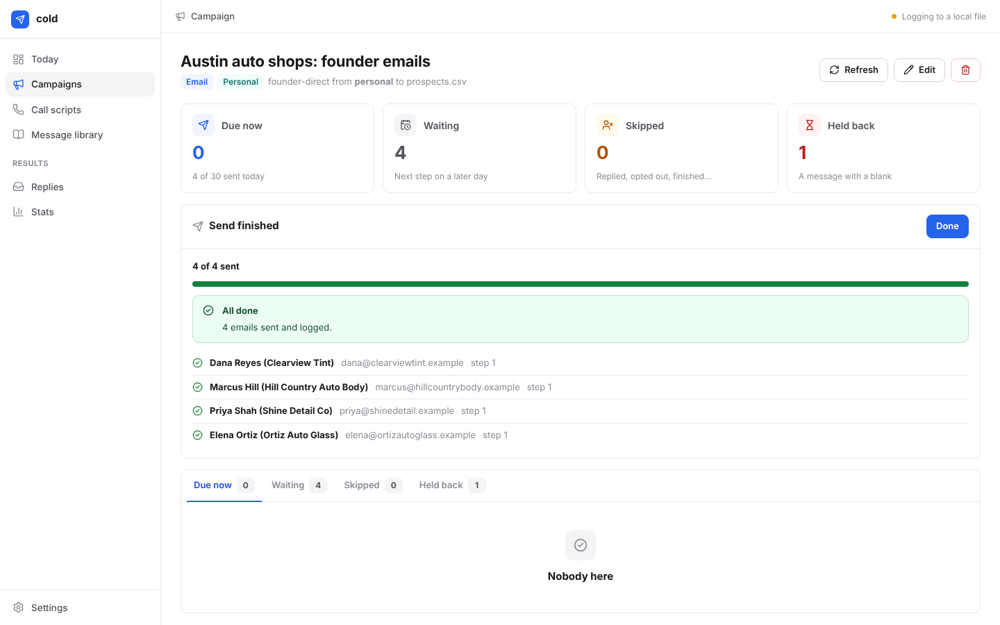
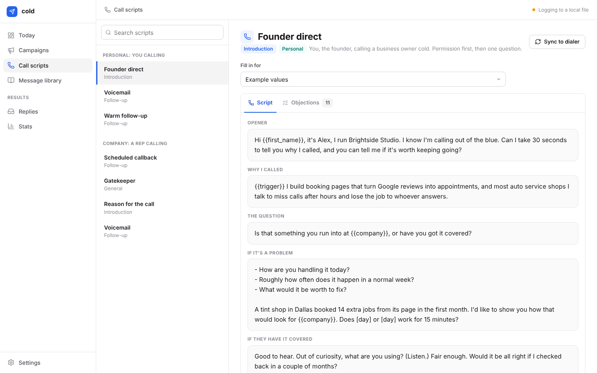
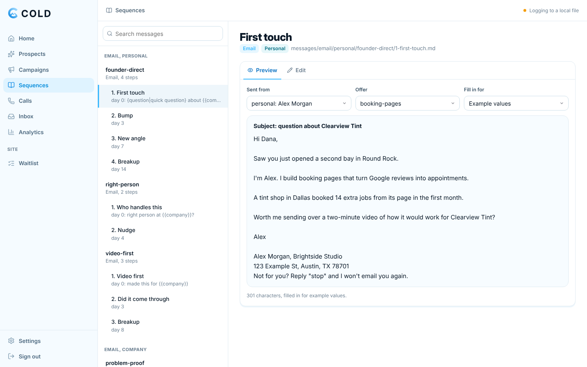
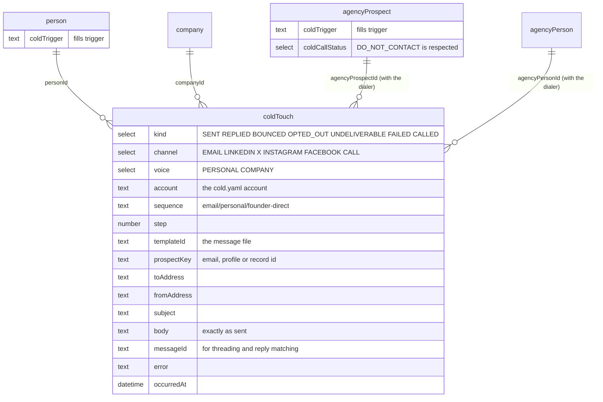

<div align="center">



<br><br>

<a href="#run-your-own"></a>&nbsp;&nbsp;
<a href="messages/README.md"></a>&nbsp;&nbsp;
<a href="docs/playbook.md"></a>

<br><br>

<a href="https://github.com/operatoruplift/cold/actions/workflows/ci.yml"></a>


<a href="LICENSE"></a>

<h3>Pick a sequence, point it at a list, and send only what is due.</h3>

<b>Plan</b> &nbsp;→&nbsp; <b>Write</b> &nbsp;→&nbsp; <b>Send</b> &nbsp;→&nbsp; <b>Log</b> &nbsp;→&nbsp; <b>Stop</b>

<br>

<a href="#how-it-works">How it works</a> &nbsp;·&nbsp;
<a href="#the-library">The library</a> &nbsp;·&nbsp;
<a href="#run-your-own">Run your own</a> &nbsp;·&nbsp;
<a href="#commands">Commands</a> &nbsp;·&nbsp;
<a href="#works-with-dialer">Works with dialer</a>

</div>

<br>

<picture>
  <source media="(prefers-color-scheme: dark)" srcset="docs/readme/screens-dark.png">
  
</picture>

<p align="center"><sub>Captured from the local app (<code>bun run ui</code>) on 30 October 2026 with the example config and the five fictional prospects in <code>examples/prospects.csv</code>. The yellow notices are the app refusing to send until it is set up.</sub></p>

**cold is a library of cold call scripts, cold DMs and cold emails for your personal and company accounts: open source, written to be sent, with every touch kept in [Twenty CRM](https://twenty.com).** Pick a sequence, point it at a list, and `cold` works out who is due for which step today. It writes each message with the prospect's details, sends the emails from your own mailbox, and lines up the DMs for you to send. It stops for anyone who replied, bounced or asked to be left alone, and logs every touch on the prospect's record in Twenty. Every message comes in two voices: **personal**, sent from your own name and profiles, and **company**, sent from the brand or a rep. Use it from a web app on your own computer (`bun run ui`) or from the command line; both do the same thing.

An [Operator Uplift](https://operatoruplift.com) project by [Matt Sim](https://rvaclassic.xyz), first published on 30 October 2026 and MIT licensed. It works with any Twenty workspace on its own, and alongside [dialer](https://github.com/matthewdonsemail-lab/dialer), a separate open-source power dialer on Twenty by Matthew ([@matthewsoldit](https://x.com/matthewsoldit)) and its contributors: run both on one workspace and they share the prospects, the call scripts and the Do Not Contact list.

<br>

## How it works

<picture>
  <source media="(prefers-color-scheme: dark)" srcset="docs/readme/flow-dark.png">
  
</picture>

- **An app you can use, on your own computer.** `bun run ui` opens it in your browser: campaigns that show who is due today, a Send button with live progress you can stop, a DM queue with Copy and Open buttons, call scripts, the message library with preview and editing, replies, stats and settings. It follows the dialer's design, and your passwords never leave your machine.
- **The messages are the product.** 45 messages across cold email, LinkedIn, X, Instagram and Facebook DMs, and call scripts, plus 11 objection answers. Every channel is covered twice, once as you and once as the company. Each message is a plain Markdown file you can read on GitHub and edit like any other text.
- **Nothing reads like a template.** Every message is built around one line only you can write: why this person, why now (<code>&#123;&#123;trigger&#125;&#125;</code>). Without it the message is held back, not sent with a blank. The other lines (who you help, what you do, the proof) are written once per offer and checked to read naturally in every sentence that uses them.
- **It stops when it should.** A reply, a bounce or an opt-out ends the sequence, and a reply on any channel stops everything automatic for 90 days: a reply is a conversation, yours to carry on. An opt-out on any channel stops every channel. A dialer prospect marked Do Not Contact is never emailed or messaged, and an email unsubscribe marks them Do Not Contact in the dialer too. Out-of-office replies and delivery delays change nothing.
- **Email that lands.** Plain text from your own mailbox with no tracking pixel. Follow-ups reply in the same thread and quote it, and fall due on calendar days in your timezone. There is a daily cap, a sending window checked before every email, and a random gap between sends. Every email carries a postal address and an opt-out, with `List-Unsubscribe` set.
- **Never the same email twice.** One address gets one message per run, even when two prospects share it. If a sent email cannot be logged, the run stops and the touch is kept locally, then saved to Twenty before the next run plans anything.
- **DMs that keep your account.** LinkedIn, X and Instagram restrict accounts that send DMs from scripts, so `cold` never does. It writes the next DM due, copies it, opens the profile, and logs what happened when you say. It keeps a daily cap per platform.
- **Calls in the dialer.** One command writes the call scripts and objection answers into the dialer's `agencyScripts`, so they sit next to every live call. For a handset, `cold call sheet` prints one filled in for a prospect.
- **It tells you what works.** `cold stats` shows the reply rate of every message and every sequence, so you keep the winners and rewrite the rest.
- **Checked like code.** `bun run check` type-checks, runs the tests (including a real SMTP round trip) and lints every message: variables, lengths, subjects, emojis, and placeholders that must never reach a prospect.

<p align="center"><sub>Bun 1.4 · TypeScript · React 19 and lucide-react, bundled by Bun · Nodemailer · ImapFlow and mailparser · YAML config · Twenty REST API · optional Reacher · bun test with a local SMTP server</sub></p>

<br>

## Status

<table>
  <tr valign="top">
    <td width="16%" align="center"></td>
    <td>The command line and the local web app. On 30 October 2026, <code>bun run check</code> passed: the type check, 138 tests in 19 files, and the lint of 45 messages, 14 sequences, 7 call scripts and 11 objections. There is no hosted version: the app listens on <code>127.0.0.1</code> only.</td>
    <td width="22%"><a href=".github/workflows/ci.yml">CI workflow</a></td>
  </tr>
  <tr valign="top">
    <td align="center"></td>
    <td>Twenty CRM. Without it the touch log is <code>.cold/touches.jsonl</code>; with it every touch lands on the person, company or dialer prospect, and Do Not Contact is shared with the dialer.</td>
    <td><a href="#works-with-dialer">Works with dialer</a></td>
  </tr>
  <tr valign="top">
    <td align="center"></td>
    <td>DMs on LinkedIn, X, Instagram and Facebook are always sent by a person. <code>cold</code> writes, copies and opens them, and logs the outcome you report.</td>
    <td><a href="docs/compliance.md">Compliance notes</a></td>
  </tr>
</table>

<br>

## The library

| | Personal (sent as you) | Company (sent as the brand or a rep) |
|---|---|---|
| **Email** | `founder-direct` (4 steps), `video-first` (3), `right-person` (2) | `problem-proof` (4), `trigger-event` (3), `video-walkthrough` (3), `right-person` (2) |
| **LinkedIn** | connection note, after accept, video offer, leave it | connection note, after accept, leave it (from a rep's profile) |
| **X** | opener, bump | opener, bump (brand account) |
| **Instagram** | opener, bump | opener, bump (brand account) |
| **Facebook** | opener, bump | none: a Page cannot message first |
| **Calls** | founder direct, warm follow-up, voicemail | reason for the call, gatekeeper, callback, voicemail |
| **Objections** | 11, answered as "I" | the same 11, answered as "we" |

Every file, the template syntax, the variables and the lint rules are described in [messages/README.md](messages/README.md). To read any of it with real data:

```bash
bun run cold preview founder-direct --source csv:examples/prospects.csv --prospect "Shine Detail"
```

<br>

## The app

<table>
  <tr>
    <td></td>
    <td></td>
  </tr>
  <tr>
    <td><b>Email campaigns.</b> Who is due, every email written out, then Send. It goes out one at a time with live progress, and you can stop it.</td>
    <td><b>The DM queue.</b> The next DM written for you. Copy it, open the profile, send it yourself, then press Sent, Replied or Opted out.</td>
  </tr>
  <tr>
    <td></td>
    <td></td>
  </tr>
  <tr>
    <td><b>Call scripts.</b> Filled in for a prospect, with every objection answer. Sync them into the dialer with one button.</td>
    <td><b>The library.</b> Read every message filled in for a real prospect, edit it, and save. Saving runs the same lint as CI.</td>
  </tr>
</table>

<p align="center"><sub>The project's own screenshots of a configured workspace, from <a href="docs/screenshots"><code>docs/screenshots</code></a>, with fictional prospects. The <a href="docs/screenshots/today.png">Today page</a> is there too.</sub></p>

| Page | What it does |
|---|---|
| Today | What's been sent, replies and opt-outs this week, and what's due in each campaign. |
| Campaigns | A sequence, the account that sends it, an offer and a prospect list (upload a CSV or use Twenty). |
| Campaign | Due now, waiting, skipped and held back, with reasons. Emails: Send, with live progress. DMs: the queue, plus a checklist download for a VA. |
| Call scripts | Every script and objection answer, filled in for a prospect. Sync to the dialer. |
| Message library | Every message, previewed with real data, editable in place. |
| Replies | Check an inbox for replies, opt-outs and bounces, and see the last 30 days. |
| Stats | Reply rate per sequence and per message. |
| Settings | Create `cold.yaml`, edit it (it is checked before saving), set the mailbox URLs and Twenty key, test each connection, and set up Twenty. |

It listens on `127.0.0.1:4100` only (`COLD_UI_PORT` changes the port). It refuses requests that come from other websites: it checks the `Host` and `Origin` headers and requires its own header on every API call. Mailbox passwords and the Twenty key stay in `.env.local`. Keep the app open while a send is running; the send stops if the app is closed.

<br>

## Run your own

<table>
  <tr valign="top">
    <td width="33%"><b>Prerequisites</b><br><sub><a href="https://bun.sh">Bun</a> (CI uses 1.4.4). A mailbox with SMTP, and IMAP to read replies. Twenty is optional: without it the touch log is a local file.</sub></td>
    <td width="33%"><b>Read first</b><br><sub>The <a href="docs/compliance.md">compliance notes</a> (CAN-SPAM, GDPR and PECR, CASL, calling rules, platform terms) and the <a href="docs/playbook.md">playbook</a> (domains, warm-up, volumes, triggers).</sub></td>
    <td width="33%"><b>What the checks prove</b><br><sub><code>bun run check</code>: the type check, the tests (including a real SMTP round trip) and the lint of every message. It is what CI runs.</sub></td>
  </tr>
</table>

### With the app

```bash
git clone https://github.com/operatoruplift/cold.git && cd cold
bun install
bun run ui             # opens http://localhost:4100
```

Then:

1. **Settings.** Create `cold.yaml` from the example, then replace the example sender and offer with yours. Under Connections, add your mailbox's SMTP URL (and IMAP, to read replies) and, optionally, your Twenty URL and key. Press Test sending, then Set up Twenty.
2. **Campaigns.** New campaign: pick a sequence, the account that sends it, and a prospect list (upload a CSV, or a Twenty source). Open it, read the emails, and press Send. For DMs, work through the queue.

### From the terminal

The same in five commands, without the app:

```bash
git clone https://github.com/operatoruplift/cold.git && cd cold
bun install
cp cold.example.yaml cold.yaml && cp .env.example .env.local   # who sends, the offer, mailbox URLs, Twenty key
bun run twenty:schema                                           # optional: the coldTouch object in Twenty
bun run cold email run founder-direct --source csv:examples/prospects.csv --dry-run
```

- `cold.yaml` holds your accounts (a `personal` one and a `company` one) and your offers, meaning who you help, what you do, the outcome, the pain and one true sentence of proof. `cold.example.yaml` explains every line.
- `.env.local` holds secrets only: one SMTP and IMAP URL per mailbox, the Twenty key, and an optional Reacher URL.
- `twenty:schema` is additive and safe to re-run, like the dialer's. It creates the `coldTouch` object and a `coldTrigger` field on people, and links touches to the dialer's prospects when they exist. `bun run twenty:schema:check` is the dry run.
- Drop `--dry-run` to send. Nothing sends until `cold.yaml` exists and you confirm the batch.

### A day with it

```bash
# Morning: emails due today, from your own mailbox (it reads replies first)
bun run cold email run founder-direct --source twenty:people --where 'jobTitle[ilike]:"%owner%"'

# The company sequence to the dialer's prospects, from the company mailbox
bun run cold email run problem-proof --source twenty:agencyProspects --where 'coldCallStatus[eq]:NEW'

# LinkedIn: write, copy, open, send by hand, log
bun run cold dm run dm/personal/linkedin --source twenty:agencyPeople

# Call block: today's scripts into the dialer, then dial
bun run cold call sync --account company --campaign "Austin tint"

# Friday: what got replies
bun run cold stats --days 30
```

Sources are a CSV (`csv:file.csv`), Twenty people (`twenty:people`), or the dialer's prospects and the people at them (`twenty:agencyProspects`, `twenty:agencyPeople`). `--where` takes a Twenty filter.

### Configuration

| Where | What |
|---|---|
| `cold.yaml` | Accounts (voice, sender details, mailbox settings, caps, sending window) and offers. Start from `cold.example.yaml`. |
| `.env.local` | `TWENTY_BASE_URL`, `TWENTY_API_KEY`, one `SMTP_URL_*` and `IMAP_URL_*` per mailbox, optional `REACHER_URL` and `REACHER_SECRET`. Start from `.env.example`. |
| `COLD_CONFIG` | Point at a config file somewhere else. |
| `COLD_UI_PORT` | The app's port, `4100` by default. |
| `TWENTY_REQUESTS_PER_MINUTE` | Twenty allows 100 a minute per key; `cold` uses 90 unless told otherwise. |

<br>

## Personal or company

The same prospect can get either. What changes is who it comes from.

| | Personal | Company |
|---|---|---|
| From | your mailbox, your LinkedIn, your X | the company mailbox or a rep, brand accounts |
| Written as | "I", signed with your first name | "we", with name, title and company |
| Best for | founder-led sales, warm-ish markets | a team, a rep, more than one person can send |
| Proof | your story | customers and numbers |

`cold` refuses to send a sequence in the other account's voice, so a "we" email never goes out from your personal mailbox by accident. A company LinkedIn page cannot start a conversation, so company LinkedIn DMs go from a rep's own profile, in the company voice.

<br>

## Works with dialer

[dialer](https://github.com/matthewdonsemail-lab/dialer) is a separate open-source power dialer on Twenty (MIT), built by Matthew and its contributors. `cold` needs none of it, but run both against one Twenty workspace and they share everything:

- **Call scripts.** `cold call sync` writes every call script for an account into `agencyScripts` in the dialer's own format (`content`, `category`, `objection_responses`), named with its voice ("Voicemail (personal)", "Voicemail (company)"). Scripts are matched per dial campaign, so `--campaign` gets its own copy. Prospect details stay as <code>&#123;&#123;first_name&#125;&#125;</code> and <code>&#123;&#123;company&#125;&#125;</code> for the rep to read off the contact.
- **Do Not Contact, both ways.** A prospect set to Do Not Contact in the dialer (or opted out of SMS) is never emailed or messaged. An email opt-out sets them to Do Not Contact in the dialer.
- **The same records.** `twenty:agencyProspects` reads the dialer's businesses, including their decision maker, rating, review count and the walkthrough video (`videoUrl` fills <code>&#123;&#123;video_url&#125;&#125;</code>). `twenty:agencyPeople` reads the people at them, with their LinkedIn and X profiles.
- **One timeline.** Every touch links to the prospect, so the contact page shows the calls from the dialer and the emails and DMs from `cold` together.

<br>

## Commands

| Command | What it does |
|---|---|
| `bun run ui` | The app, at http://localhost:4100 (`--no-open` to not open a browser, `--dev` to rebuild on change) |
| `cold list` | Every sequence and script, with when to use it |
| `cold lint` | Check every message; exits 1 on an error |
| `cold variables` | The variables a message can use |
| `cold preview <id>` | Read a message, sequence or script filled in, with example or real prospect data |
| `cold twenty:schema` | Create `coldTouch` and its fields in Twenty (`--dry-run` to check) |
| `cold email run <sequence>` | Send the steps due today (`--dry-run` first) |
| `cold email sync` | Log replies, opt-outs and bounces from the inbox |
| `cold email verify` | Check addresses with Reacher (`--record` suppresses invalid ones) |
| `cold dm run <sequence>` | Work through today's DMs, or `--export` a checklist for a VA |
| `cold call sync` | Write the call scripts into the dialer |
| <code>cold call sheet &lt;script&gt;</code> | Print a call script and every objection answer |
| `cold stats` | Reply rate per message and per sequence |
| `cold log <prospect>` | Log a touch by hand (a reply on the phone, an opt-out) |

`bun run cold help` lists every flag. Ids shorten to any unique ending: `founder-direct`, `call/company/gatekeeper`.

<br>

## Rules it enforces

- A message with an empty variable is held back, never sent with a gap.
- A sequence only goes out from an account in its own voice.
- Every email has a postal address and an opt-out line, or nothing sends.
- Subjects never start with "Re:" or "Fwd:" unless the email really is a reply.
- No emojis, and no `[placeholder]` in anything written.
- One sequence per channel per prospect at a time, with 30 days between them.
- Nobody who replied anywhere in the last 90 days is sent anything automatic.
- One address gets one message per run.
- Daily caps per mailbox and per DM platform, and a sending window in your timezone, checked before every email.
- Only a recipient's server refusing the address counts as a bounce. A refused sender (a sending limit, bad credentials) stops the run instead, and a delivery delay is ignored.
- A send that cannot be logged stops the run, and is saved before the next one plans anything.
- The example config can preview but never send, or write scripts into the dialer.

The legal side (CAN-SPAM, GDPR and PECR, CASL, calling rules, platform terms) is in [docs/compliance.md](docs/compliance.md). How to run the sequences well (domains, warm-up, volumes, writing triggers) is in [docs/playbook.md](docs/playbook.md).

<details>
<summary><b>How a run works, step by step</b></summary>
<br>

```mermaid
flowchart TB
    src["Prospects<br/>CSV, Twenty people,<br/>dialer prospects"]
    lib["The message library<br/>messages/*.md, linted"]
    cfg["cold.yaml<br/>account + offer"]

    plan{"Who is due?<br/>step N on day N"}
    stop["Skipped<br/>replied, opted out, bounced,<br/>Do Not Contact, finished,<br/>another sequence running"]
    render["Write each message<br/>held back if a variable is empty"]
    guard["Guards<br/>voice, footer, daily cap,<br/>sending window, confirm"]

    email["Email<br/>SMTP from your mailbox,<br/>threaded, plain text"]
    dm["DM<br/>copied and opened,<br/>you send it"]
    call["Calls<br/>scripts in the dialer"]

    log[("Twenty<br/>coldTouches on the person,<br/>company or dialer prospect")]
    sync["cold email sync<br/>IMAP: replies, opt-outs, bounces"]

    src --> plan
    cfg --> plan
    lib --> plan
    plan -->|"not due"| stop
    plan -->|"due"| render --> guard
    guard --> email --> log
    guard --> dm --> log
    lib --> call
    sync --> log
    log -->|"history"| plan

    classDef store fill:#eef2ff,stroke:#4f46e5,color:#1e1b4b
    classDef skip fill:#fffbeb,stroke:#d97706,color:#451a03
    class log store
    class stop skip
```

</details>

<details>
<summary><b>Data model</b></summary>
<br>



One append-only log is the whole state: what was sent, what came back, who asked to be left alone. There is no database of its own. The event field is `kind` because `event` is a reserved name in Twenty. Without Twenty, the same records go to `.cold/touches.jsonl`.

</details>

<details>
<summary><b>The open-source stack</b></summary>
<br>

| Project | License | What it does here |
|---|---|---|
| [Twenty](https://github.com/twentyhq/twenty) | AGPLv3 | The CRM and system of record: prospects, people, and every touch |
| [dialer](https://github.com/matthewdonsemail-lab/dialer) | MIT | The power dialer the call scripts sync into |
| [Nodemailer](https://github.com/nodemailer/nodemailer) | MIT-0 | Sends each email over SMTP, from your own mailbox |
| [ImapFlow](https://github.com/postalsys/imapflow) and [mailparser](https://github.com/nodemailer/mailparser) | MIT | Read the inbox for replies, opt-outs and bounces |
| [Reacher](https://github.com/reacherhq/check-if-email-exists) | MIT | Optional, self-hosted: checks an address exists before the first email |
| [Cal.com](https://github.com/calcom/cal.com) | MIT | Your booking link (<code>&#123;&#123;booking_url&#125;&#125;</code>) |
| [Cap](https://github.com/CapSoftware/Cap) | AGPLv3 | Records the personal videos the video sequences send (<code>&#123;&#123;video_url&#125;&#125;</code>) |
| [Bun](https://bun.sh) | MIT | Runs it, tests it, loads `.env.local` |

`cold` talks to Twenty over its API and includes none of its code.

</details>

<details>
<summary><b>Repository layout</b></summary>
<br>

```
messages/                 the library (see messages/README.md)
src/
  cli.ts                  the cold command
  web/                    the app: React pages, bundled by Bun
  domains/
    web/                  the app's server: API, request guard, campaigns, send jobs
    messages/             load and lint the library
    render/               the template syntax and the variable contract
    config/               cold.yaml
    prospects/            CSV and Twenty sources, identities
    touches/              the touch log (Twenty or file) and the sequence planner
    outreach/             variables and rendering per prospect
    email/                build, send, sync replies, verify
    dm/                   the DM queue
    call/                 dialer script sync and call sheets
    stats/                reply rates
    twenty/               the API client and the schema
    cli/                  terminal input and output
docs/                     playbook, compliance, screenshots and README images
examples/prospects.csv    five fictional prospects
```

The code follows dialer's layout: camelCase `domains/<domain>/<primitive>`, pure helpers under `helpers/`, input and output in `index.ts`, tests next to the code. The Twenty schema setup is adapted from dialer's (MIT); see [THIRD_PARTY_NOTICES.md](THIRD_PARTY_NOTICES.md).

</details>

<br>

## Checks

```bash
bun run check        # typecheck + tests + message lint, what CI runs
bun test             # tests only
bun run lint:messages
```

<br>

## Documentation

<table>
  <tr valign="top">
    <td width="33%"><b>Write it</b><br><sub><a href="messages/README.md">The message library and its rules</a><br><a href="docs/playbook.md">Playbook: domains, warm-up, volumes, triggers</a></sub></td>
    <td width="33%"><b>Stay within the rules</b><br><sub><a href="docs/compliance.md">Compliance: CAN-SPAM, GDPR and PECR, CASL, calls</a><br><a href="SECURITY.md">Security and reporting</a></sub></td>
    <td width="33%"><b>Change it</b><br><sub><a href="CONTRIBUTING.md">Contributing</a><br><a href="CHANGELOG.md">Changelog</a><br><a href="THIRD_PARTY_NOTICES.md">Third-party notices</a></sub></td>
  </tr>
</table>

<br>

<p align="center"><sub>MIT licensed (see <a href="LICENSE">LICENSE</a>). The Twenty schema setup adapted from dialer keeps its MIT notice; see <a href="THIRD_PARTY_NOTICES.md">THIRD_PARTY_NOTICES.md</a>.</sub></p>

<p align="center"><sub>Built by <a href="https://rvaclassic.xyz">Matt Sim</a>, founder of <a href="https://operatoruplift.com">Operator Uplift</a>. More builds at <a href="https://github.com/operatoruplift">github.com/operatoruplift</a>. Want one built for your product? <a href="https://cal.com/rvaclassic/15min">Book a 15-minute call</a>.</sub></p>
