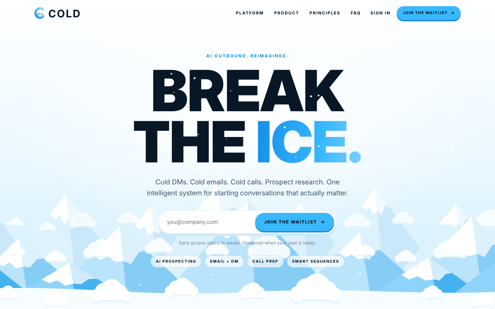
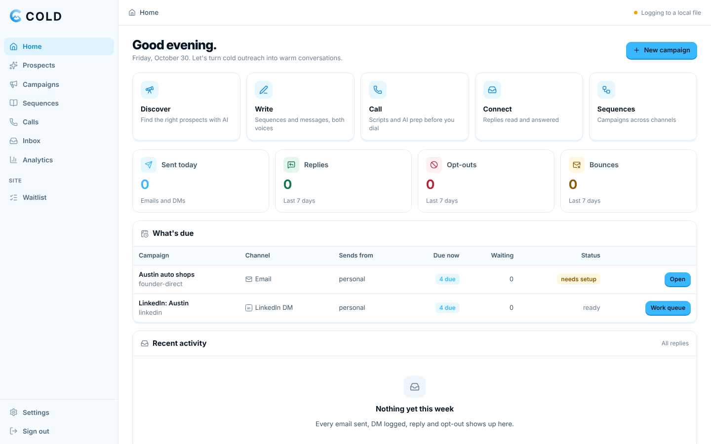
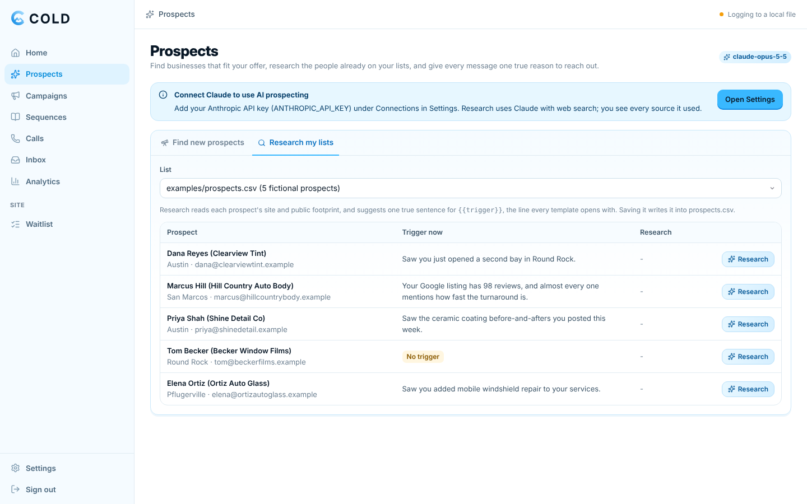
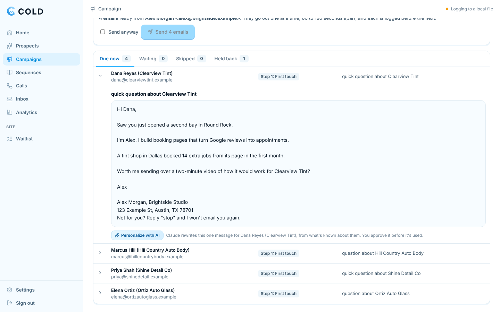
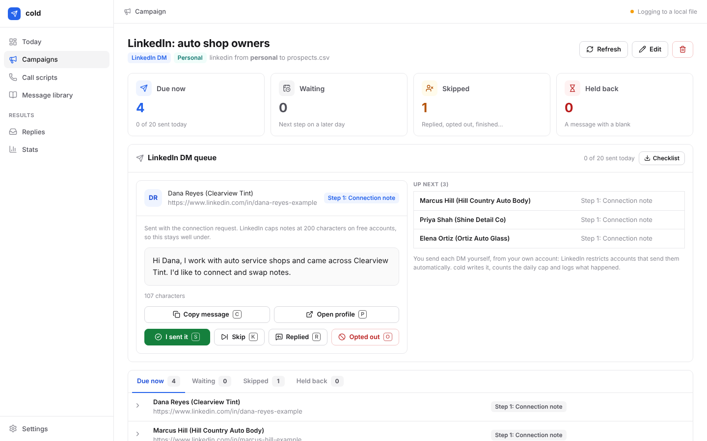
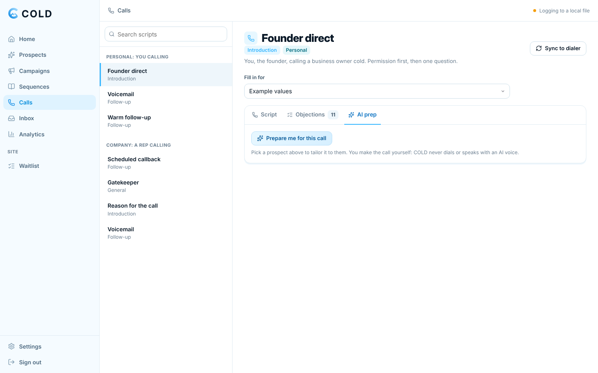
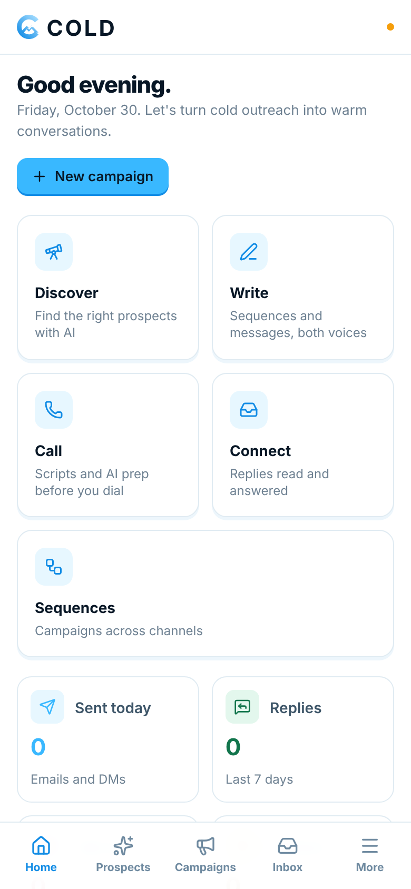
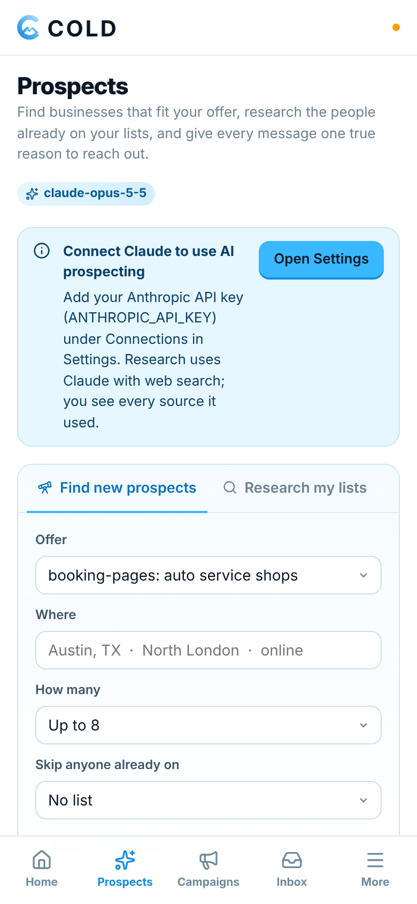
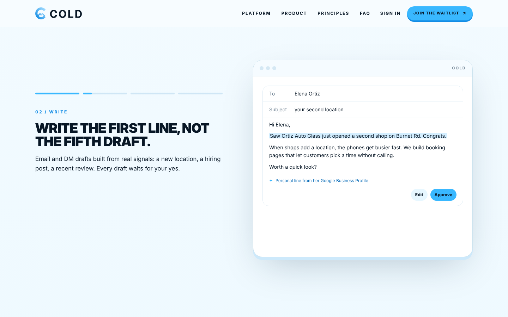
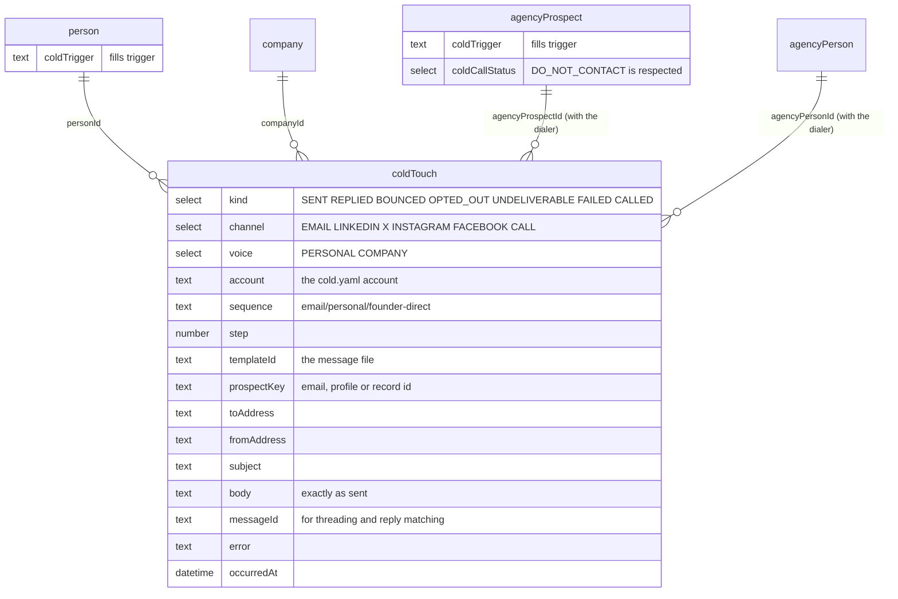

<p align="center">
  
</p>

<h3 align="center">Break the ice. AI outbound, reimagined.</h3>

<p align="center">
  Cold DMs, cold emails, cold calls and prospect research for your personal and
  company accounts. Open source, written to be sent, with every touch kept in
  <a href="https://twenty.com">Twenty CRM</a>.
</p>

<p align="center">
  <a href="LICENSE"></a>
  <a href="https://bun.sh"></a>
  <a href="https://twenty.com"></a>
  <a href="https://docs.anthropic.com"></a>
</p>

<p align="center">
  
</p>

Built by [Operator Uplift](https://github.com/operatoruplift). COLD is three
things in one small server:

- **A public site** at `/`, with your waitlist.
- **Your app** at `/app/`, behind a login only you have: install it on your
  desktop or phone and it works like a native app.
- **The engine underneath**: pick a sequence, point it at a list, and COLD
  works out who is due for which step today. It writes each message with the
  prospect's details, sends the emails from your own mailbox, lines up the DMs
  for you to send, and prepares your calls. It stops for anyone who replied,
  bounced or asked to be left alone, and logs every touch in Twenty.

Claude does the research and the first drafts: it finds businesses that fit
your offer, reads their public footprint for one true reason to reach out,
personalizes each message, preps each call and reads each reply. **You approve
everything.** Nothing is sent by AI on its own, DMs are always sent by you, and
calls are always made by you.

Every message comes in two voices: **personal**, sent from your own name and
profiles, and **company**, sent from the brand or a rep. It works with any
Twenty workspace on its own, and alongside
[dialer](https://github.com/matthewdonsemail-lab/dialer), the open-source power
dialer on Twenty: run both on one workspace and they share the prospects, the
call scripts and the Do Not Contact list.

## Why it works

- **An app that's yours alone.** `bun run ui` opens it on your computer, or
  host it and install it on your phone. Campaigns that show who is due today,
  a Send button with live progress you can stop, a DM queue with Copy and Open
  buttons, call scripts, the message library, the inbox, analytics, your
  waitlist and settings, behind a login only you have. Your mailbox passwords
  and API keys stay on your machine or your server.
- **AI that shows its work.** Claude finds prospects and researches them with
  web search, and every claim comes with the page it was read on. Drafts,
  call prep and reply answers wait for your approval; nothing goes out on its
  own.
- **The messages are the product.** 45 messages across cold email, LinkedIn,
  X, Instagram and Facebook DMs, and call scripts, plus 11 objection answers. Every
  channel is covered twice, once as you and once as the company. Each message
  is a plain Markdown file you can read on GitHub and edit like any other text.
- **Nothing reads like a template.** Every message is built around one line
  only you can write: why this person, why now (`{{trigger}}`). Without it the
  message is held back, not sent with a blank. The other lines (who you help,
  what you do, the proof) are written once per offer and checked to read
  naturally in every sentence that uses them.
- **It stops when it should.** A reply, a bounce or an opt-out ends the
  sequence, and a reply on any channel stops everything automatic for 90 days:
  a reply is a conversation, yours to carry on. An opt-out on any channel stops
  every channel. A dialer prospect marked Do Not Contact is never emailed or
  messaged, and an email unsubscribe marks them Do Not Contact in the dialer
  too. Out-of-office replies and delivery delays change nothing.
- **Email that lands.** Plain text from your own mailbox with no tracking
  pixel. Follow-ups reply in the same thread and quote it, and fall due on
  calendar days in your timezone. There is a daily cap, a sending window checked
  before every email, and a random gap between sends. Every email carries a
  postal address and an opt-out, with `List-Unsubscribe` set.
- **Never the same email twice.** One address gets one message per run, even
  when two prospects share it. If a sent email cannot be logged, the run stops
  and the touch is kept locally, then saved to Twenty before the next run plans
  anything.
- **DMs that keep your account.** LinkedIn, X and Instagram restrict accounts
  that send DMs from scripts, so `cold` never does. It writes the next DM due,
  copies it, opens the profile, and logs what happened when you say. It keeps
  a daily cap per platform.
- **Calls in the dialer.** One command writes the call scripts and objection
  answers into the dialer's `agencyScripts`, so they sit next to every live
  call. For a handset, `cold call sheet` prints one filled in for a prospect.
- **It tells you what works.** `cold stats` shows the reply rate of every
  message and every sequence, so you keep the winners and rewrite the rest.
- **Checked like code.** `bun run check` type-checks, runs the tests (including
  a real SMTP round trip) and lints every message: variables, lengths,
  subjects, emojis, and placeholders that must never reach a prospect.

## The library

| | Personal (sent as you) | Company (sent as the brand or a rep) |
|---|---|---|
| **Email** | `founder-direct` (4 steps), `video-first` (3), `right-person` (2) | `problem-proof` (4), `trigger-event` (3), `video-walkthrough` (3), `right-person` (2) |
| **LinkedIn** | connection note, after accept, video offer, leave it | connection note, after accept, leave it (from a rep's profile) |
| **X** | opener, bump | opener, bump (brand account) |
| **Instagram** | opener, bump | opener, bump (brand account) |
| **Facebook** | opener, bump | none: a Page cannot message first |
| **Calls** | founder direct, warm follow-up, voicemail | reason for the call, gatekeeper, callback, voicemail |
| **Objections** | 11, answered as "I" | the same 11, answered as "we" |

Every file, the template syntax, the variables and the lint rules are
described in [messages/README.md](messages/README.md). To read any of it with
real data:

```bash
bun run cold preview founder-direct --source csv:examples/prospects.csv --prospect "Shine Detail"
```

## The app

<table>
  <tr>
    <td></td>
    <td></td>
  </tr>
  <tr>
    <td><b>Home.</b> What's sent, replies and opt-outs this week, what's due in each campaign, and a tile for each job: discover, write, call, connect, sequences.</td>
    <td><b>Prospects.</b> Claude finds businesses that fit your offer (with the pages it read), or researches the people on your lists and suggests one true trigger line for each.</td>
  </tr>
  <tr>
    <td></td>
    <td></td>
  </tr>
  <tr>
    <td><b>Email campaigns.</b> Who is due, every email written out, then Send. Personalize any one with AI, edit it, approve it: the approved version goes out, with your footer and opt-out line.</td>
    <td><b>The DM queue.</b> The next DM written for you (or personalized). Copy it, open the profile, send it yourself, then press Sent, Replied or Opted out.</td>
  </tr>
  <tr>
    <td></td>
    <td> </td>
  </tr>
  <tr>
    <td><b>Calls.</b> Every script and objection answer, filled in for a prospect, plus AI prep: an opener from a true fact, questions, objection answers and a voicemail. You dial.</td>
    <td><b>On your phone.</b> Install COLD from the browser and it opens full screen, with tabs along the bottom. It keeps working offline for what you've already opened.</td>
  </tr>
</table>

| Page | What it does |
|---|---|
| Home | What's been sent, replies and opt-outs this week, and what's due in each campaign. |
| Prospects | Find new prospects with Claude and web search, save them as a list; research a list and save a trigger line per person. |
| Campaigns | A sequence, the account that sends it, an offer and a prospect list (upload a CSV, use an AI list, or use Twenty). |
| Campaign | Due now, waiting, skipped and held back, with reasons. Personalize any due message with AI and approve it. Emails: Send, with live progress. DMs: the queue, plus a checklist download for a VA. |
| Sequences | Every message, previewed with real data, editable in place. |
| Calls | Every script and objection answer, filled in for a prospect, and AI call prep. Sync scripts to the dialer. |
| Inbox | Check an inbox for replies, opt-outs and bounces. Claude reads each reply, sorts it (interested, not now, wants out...) and drafts your answer. |
| Analytics | Reply rate per sequence and per message. |
| Waitlist | Everyone who joined on your site, with their role and channels. Mark them invited, export a CSV. |
| Settings | Your login and devices, the AI connection, `cold.yaml` (checked before saving), mailbox URLs, the Twenty key, and a test for each. |

### The site and the waitlist

<p align="center">
  
</p>

The public site is COLD's landing page: the hero with drifting cloud banks
and alpine ridges that part as you scroll, a pinned four-step section
(discover, write, reach, connect) whose copy flips in while the product screen
slides to match, the product, the principles, and the waitlist. Its motion
takes after [ListeningKit](https://listeningkit.com)'s site; the brand is
COLD's (see [docs/brand.md](docs/brand.md)). Signups land on the Waitlist page,
with a hidden honeypot field and a per-address limit against bots. The site
needs no JavaScript to read, and honors reduced motion.

### Your login

The app has one owner: you. The first time COLD starts it prints a one-time
setup code, and opens `/app/?setup=<code>` on your computer, where you choose
the email and password you'll sign in with. Passwords are hashed with
argon2id; sessions are random tokens in an `HttpOnly`, `SameSite=Strict`
cookie (and `Secure` over HTTPS), valid for 30 days of use. After ten tries
from one address, sign-in waits out the rest of a 15-minute window. Forgot it?
Reset it where COLD runs:

```bash
bun run cold owner
```

### Install it

COLD is a progressive web app: install it once and it has its own icon and
window, on your desktop and your phone.

- **Desktop (Chrome, Edge, Brave):** the install button in the address bar, or
  **Install COLD** in the sidebar. Or run `bun run desktop` to open it in its
  own window straight away.
- **Mac (Safari):** File, Add to Dock.
- **iPhone and iPad:** Share, Add to Home Screen.
- **Android:** the install prompt, or the menu, Install app.

On your own computer that works at `http://localhost:4100/app/`. To use COLD
from your phone, host it (next section): installing needs HTTPS.

### AI

Add your Anthropic API key (`ANTHROPIC_API_KEY`) under Settings, Connections.
COLD uses Claude's Opus model unless `COLD_AI_MODEL` names another:

| Job | How it stays honest |
|---|---|
| Find prospects | Claude searches the web and reads the pages. Each result lists the pages it came from; a source Claude didn't open in that search is dropped. Contact details are only what the business publishes; email addresses are never guessed. |
| Research a prospect | Same rules. It suggests a trigger sentence for `{{trigger}}`; a trigger whose source wasn't opened is dropped. Saving writes it into your CSV or Twenty. |
| Personalize a message | Rewrites one due message using only what's known about the prospect, keeps the offer and the ask, and refuses to leave a `{{variable}}` or exceed a DM's length limit. It's a draft until you approve it. |
| Call prep | An opener from a true fact, questions, objection answers built on the script's own, a voicemail. For you to say: COLD never dials or speaks with an AI voice. |
| Reply triage | Sorts a reply (interested, question, not now, not interested, wants out, wrong person, away) and drafts your answer. A request to stop gets a one-click opt-out that keeps them out of every sequence and channel. |

Research runs in the background (a search takes a minute or two) and survives a
page reload. Every request is recorded with its tokens and searches; Settings
shows the last 30 days. Requests use Claude's server-side fallback, so one the
model declines for policy reasons is retried on Anthropic's recommended
fallback model.

### The decision engine

**Prospects, Score and prioritize** ranks a list by how likely each prospect
is to buy, and says how to write to them:

- **Diligence** reads each prospect's public site (safely, within robots.txt)
  for what they need, with the words on their pages that show it. With a SubQ
  key (`SUBQ_API_KEY`), Subquadratic's long-context model reads every page in
  one pass; otherwise Claude does, with a few web searches of its own.
- **Scoring** asks a decision model ten typed questions (fit, need, timing,
  who decides, can they pay, tone, opening, objection, channel, next step).
  With a TypeSafe key (`TYPESAFE_API_KEY`) that is Jev, TypeSafe's System One
  model; otherwise Claude. The answers become a 0 to 100 score, a tier, a next
  step and the reasons; an unsure call is flagged for you to check.
- **Drafts** are written in the tone and opening picked for that person,
  around their need. You can pick your own.
- **Campaigns** can send to the highest scores first when the daily cap
  can't reach everyone.
- **It learns.** Each approved draft's tone and opening is matched to what
  happened (a reply, a no, silence for two weeks), and Thompson sampling
  shifts later picks toward what gets answered. **Stats, What's working**
  shows the reply rate of each, with how sure it is.

How it works, the data it sends where, and the roadmap to selling it to other
businesses as a service: [docs/decision-engine.md](docs/decision-engine.md).

## Run your own

You need [Bun](https://bun.sh). Twenty is optional: without it the touch log is
a local file.

```bash
git clone https://github.com/operatoruplift/cold.git && cd cold
```

```bash
bun install
```

```bash
bun run ui
```

COLD prints its addresses and a one-time setup code, and your browser opens
the app at http://localhost:4100/app/ to create your login. The site is at
http://localhost:4100. Then:

1. **Settings.** Create `cold.yaml` from the example, then replace the example
   sender and offer with yours. Under Connections, add your mailbox's SMTP URL
   (and IMAP, to read replies), your Anthropic API key for the AI features,
   and, optionally, your Twenty URL and key. Press Test sending, then Set up
   Twenty.
2. **Prospects.** Find prospects with AI, or research the list you have.
3. **Campaigns.** New campaign: pick a sequence, the account that sends it, and
   a prospect list. Open it, read the emails (personalize the ones that
   matter), and press Send. For DMs, work through the queue.

`bun run desktop` does the same and opens the app in its own window. On a
computer it listens on `127.0.0.1:4100` only (`COLD_UI_PORT` changes the
port), and refuses requests from other websites: it checks the `Host` and
`Origin` headers and requires its own header on every API call. A send is
saved after every email, so if you close COLD mid-way it carries on where it
stopped the next time COLD starts.

### Host it

To reach COLD from your phone, share the site and collect a waitlist, put it
on the web. On **Vercel** (the repository carries its `vercel.json`) the site
and the app are served from Vercel's CDN, the API runs as one function, and
everything you save lives in a free Turso database: add Turso to the project,
deploy, and open the setup link from the function's logs. Or run the
**Dockerfile** on any host that keeps a disk (Railway, Render, Fly, a VPS).
Step by step: [docs/deploy.md](docs/deploy.md).

### From the terminal

The same in five commands, without the app:

```bash
git clone https://github.com/operatoruplift/cold.git && cd cold
bun install
cp cold.example.yaml cold.yaml && cp .env.example .env.local   # who sends, the offer, mailbox URLs, Twenty key
bun run twenty:schema                                           # optional: the coldTouch object in Twenty
bun run cold email run founder-direct --source csv:examples/prospects.csv --dry-run
```

- `cold.yaml` holds your accounts (a `personal` one and a `company` one) and
  your offers, meaning who you help, what you do, the outcome, the pain and
  one true sentence of proof. `cold.example.yaml` explains every line.
- `.env.local` holds secrets only: one SMTP and IMAP URL per mailbox, the
  Twenty key, and an optional Reacher URL.
- `twenty:schema` is additive and safe to re-run, like the dialer's. It
  creates the `coldTouch` object and a `coldTrigger` field on people, and links
  touches to the dialer's prospects when they exist. `bun run
  twenty:schema:check` is the dry run.
- Drop `--dry-run` to send. Nothing sends until `cold.yaml` exists and you
  confirm the batch.

## A day with it

```bash
# Morning: emails due today, from your own mailbox (it reads replies first)
bun run cold email run founder-direct --source twenty:people --where 'jobTitle[ilike]:"%owner%"'

# The company sequence to the dialer's prospects, from the company mailbox
bun run cold email run problem-proof --source twenty:agencyProspects --where 'coldCallStatus[eq]:NEW'

# LinkedIn: write, copy, open, send by hand, log
bun run cold dm run dm/personal/linkedin --source twenty:agencyPeople

# Call block: today's scripts into the dialer, then dial
bun run cold call sync --account company --campaign "Austin tint"

# Friday: what got replies
bun run cold stats --days 30
```

Sources are a CSV (`csv:file.csv`), Twenty people (`twenty:people`), or the
dialer's prospects and the people at them (`twenty:agencyProspects`,
`twenty:agencyPeople`). `--where` takes a Twenty filter.

## Personal or company

The same prospect can get either. What changes is who it comes from.

| | Personal | Company |
|---|---|---|
| From | your mailbox, your LinkedIn, your X | the company mailbox or a rep, brand accounts |
| Written as | "I", signed with your first name | "we", with name, title and company |
| Best for | founder-led sales, warm-ish markets | a team, a rep, more than one person can send |
| Proof | your story | customers and numbers |

`cold` refuses to send a sequence in the other account's voice, so a "we" email
never goes out from your personal mailbox by accident. A company LinkedIn page
cannot start a conversation, so company LinkedIn DMs go from a rep's own
profile, in the company voice.

## How a run works

```mermaid
flowchart TB
    src["Prospects<br/>CSV, Twenty people,<br/>dialer prospects"]
    lib["The message library<br/>messages/*.md, linted"]
    cfg["cold.yaml<br/>account + offer"]

    plan{"Who is due?<br/>step N on day N"}
    stop["Skipped<br/>replied, opted out, bounced,<br/>Do Not Contact, finished,<br/>another sequence running"]
    render["Write each message<br/>held back if a variable is empty"]
    guard["Guards<br/>voice, footer, daily cap,<br/>sending window, confirm"]

    email["Email<br/>SMTP from your mailbox,<br/>threaded, plain text"]
    dm["DM<br/>copied and opened,<br/>you send it"]
    call["Calls<br/>scripts in the dialer"]

    log[("Twenty<br/>coldTouches on the person,<br/>company or dialer prospect")]
    sync["cold email sync<br/>IMAP: replies, opt-outs, bounces"]

    src --> plan
    cfg --> plan
    lib --> plan
    plan -->|"not due"| stop
    plan -->|"due"| render --> guard
    guard --> email --> log
    guard --> dm --> log
    lib --> call
    sync --> log
    log -->|"history"| plan

    classDef store fill:#eef2ff,stroke:#4f46e5,color:#1e1b4b
    classDef skip fill:#fffbeb,stroke:#d97706,color:#451a03
    class log store
    class stop skip
```

## Works with dialer

[dialer](https://github.com/matthewdonsemail-lab/dialer) is a separate open-source
power dialer on Twenty (MIT). `cold` needs none of it, but run both against
one Twenty workspace and they share everything:

- **Call scripts.** `cold call sync` writes every call script for an account
  into `agencyScripts` in the dialer's own format (`content`, `category`,
  `objection_responses`), named with its voice ("Voicemail (personal)",
  "Voicemail (company)"). Scripts are matched per dial campaign, so
  `--campaign` gets its own copy. Prospect details stay as `{{first_name}}` and
  `{{company}}` for the rep to read off the contact.
- **Do Not Contact, both ways.** A prospect set to Do Not Contact in the dialer
  (or opted out of SMS) is never emailed or messaged. An email opt-out sets
  them to Do Not Contact in the dialer.
- **The same records.** `twenty:agencyProspects` reads the dialer's businesses,
  including their decision maker, rating, review count and the walkthrough
  video (`videoUrl` fills `{{video_url}}`). `twenty:agencyPeople` reads the
  people at them, with their LinkedIn and X profiles.
- **One timeline.** Every touch links to the prospect, so the contact page shows
  the calls from the dialer and the emails and DMs from `cold` together.

## The open-source stack

| Project | License | What it does here |
|---|---|---|
| [Twenty](https://github.com/twentyhq/twenty) | AGPLv3 | The CRM and system of record: prospects, people, and every touch |
| [dialer](https://github.com/matthewdonsemail-lab/dialer) | MIT | The power dialer the call scripts sync into |
| [Nodemailer](https://github.com/nodemailer/nodemailer) | MIT-0 | Sends each email over SMTP, from your own mailbox |
| [ImapFlow](https://github.com/postalsys/imapflow) and [mailparser](https://github.com/nodemailer/mailparser) | MIT | Read the inbox for replies, opt-outs and bounces |
| [Reacher](https://github.com/reacherhq/check-if-email-exists) | MIT | Optional, self-hosted: checks an address exists before the first email |
| [Cal.com](https://github.com/calcom/cal.com) | MIT | Your booking link (`{{booking_url}}`) |
| [Cap](https://github.com/CapSoftware/Cap) | AGPLv3 | Records the personal videos the video sequences send (`{{video_url}}`) |
| [Bun](https://bun.sh) | MIT | Runs it, serves it, bundles the site and the app, stores the waitlist and logins in SQLite |
| [Turso](https://turso.tech) via [@libsql/client](https://github.com/tursodatabase/libsql-client-ts) | MIT (client) | The same SQLite, over the network, when COLD runs on Vercel |
| [Claude](https://docs.anthropic.com) via [@anthropic-ai/sdk](https://github.com/anthropics/anthropic-sdk-typescript) | MIT (SDK) | Prospect research with web search, drafts, call prep, reply triage |
| [React](https://react.dev) and [Lucide](https://lucide.dev) | MIT, ISC | The app's interface and icons |
| [Inter](https://rsms.me/inter/) via [Fontsource](https://fontsource.org) | OFL 1.1 | The type: Inter Display for headings, Inter for everything else |

`cold` talks to Twenty over its API and includes none of its code.

## Data model



One append-only log is the whole state: what was sent, what came back, who
asked to be left alone. There is no database of its own. The event field is
`kind` because `event` is a reserved name in Twenty. Without Twenty, the same
records go to `.cold/touches.jsonl`.

## Commands

| Command | What it does |
|---|---|
| `bun run ui` | The site and the app on your computer: http://localhost:4100 and /app/ (`--no-open` to not open a browser) |
| `bun run desktop` | The same, with the app in its own window |
| `bun run start` | The server without opening anything (what a host runs) |
| `bun run build` | Bundle the site and the app into `dist/`, which a server with `NODE_ENV=production` serves instead of bundling at start (the Dockerfile runs it) |
| `bun run dev` | Restart on every change, for working on COLD itself |
| `cold owner` | Create or reset your login (`cold owner hash` prints a hash for `COLD_OWNER_PASSWORD_HASH`) |
| `cold list` | Every sequence and script, with when to use it |
| `cold lint` | Check every message; exits 1 on an error |
| `cold variables` | The variables a message can use |
| `cold preview <id>` | Read a message, sequence or script filled in, with example or real prospect data |
| `cold twenty:schema` | Create `coldTouch` and its fields in Twenty (`--dry-run` to check) |
| `cold email run <sequence>` | Send the steps due today (`--dry-run` first) |
| `cold email sync` | Log replies, opt-outs and bounces from the inbox |
| `cold email verify` | Check addresses with Reacher (`--record` suppresses invalid ones) |
| `cold dm run <sequence>` | Work through today's DMs, or `--export` a checklist for a VA |
| `cold call sync` | Write the call scripts into the dialer |
| `cold call sheet <script>` | Print a call script and every objection answer |
| `cold stats` | Reply rate per message and per sequence |
| `cold log <prospect>` | Log a touch by hand (a reply on the phone, an opt-out) |

`bun run cold help` lists every flag. Ids shorten to any unique ending:
`founder-direct`, `call/company/gatekeeper`.

## Rules it enforces

- A message with an empty variable is held back, never sent with a gap.
- A sequence only goes out from an account in its own voice.
- Every email has a postal address and an opt-out line, or nothing sends.
- Subjects never start with "Re:" or "Fwd:" unless the email really is a reply.
- No emojis, and no `[placeholder]` in anything written.
- One sequence per channel per prospect at a time, with 30 days between them.
- Nobody who replied anywhere in the last 90 days is sent anything automatic.
- One address gets one message per run.
- Daily caps per mailbox and per DM platform, and a sending window in your
  timezone, checked before every email.
- Only a recipient's server refusing the address counts as a bounce. A refused
  sender (a sending limit, bad credentials) stops the run instead, and a
  delivery delay is ignored.
- A send that cannot be logged stops the run, and is saved before the next one
  plans anything.
- The example config can preview but never send, or write scripts into the
  dialer.

The legal side (CAN-SPAM, GDPR and PECR, CASL, calling rules, platform terms) is
in [docs/compliance.md](docs/compliance.md). How to run the sequences well
(domains, warm-up, volumes, writing triggers) is in
[docs/playbook.md](docs/playbook.md).

## Configuration

| Where | What |
|---|---|
| `cold.yaml` | Accounts (voice, sender details, mailbox settings, caps, sending window) and offers. Start from `cold.example.yaml`. |
| `.env.local` | `TWENTY_BASE_URL`, `TWENTY_API_KEY`, one `SMTP_URL_*` and `IMAP_URL_*` per mailbox, `ANTHROPIC_API_KEY`, optional `TYPESAFE_API_KEY` (Jev), `SUBQ_API_KEY` (SubQ), `REACHER_URL` and `REACHER_SECRET`. Start from `.env.example`, or set them in Settings. |
| `cold.yaml`, `decide:` | Who decides and who does diligence (`auto`, or pin one), when a call goes to you to check, and whether styles are explored. See [docs/decision-engine.md](docs/decision-engine.md). |
| `.cold/cold.db` | The waitlist, your login and sessions, AI runs and drafts, decisions and what the engine learned, and email sends (SQLite). |
| `COLD_DATABASE_URL`, `COLD_DATABASE_TOKEN` | Use a Turso (libSQL) database instead; the Turso integration on Vercel sets `TURSO_DATABASE_URL` and `TURSO_AUTH_TOKEN`, which work too. There your files, the touch log and saved keys live in it as well. |
| `COLD_SECRET_KEY` | On a database: encrypts the keys and passwords saved in Settings. |
| `COLD_CONFIG` | Point at a config file somewhere else. |
| `COLD_HOME` | Keep `cold.yaml`, `.env.local`, `.cold/`, prospect lists and a copy of `messages/` in another folder (a server's volume). |
| `COLD_PUBLIC_URL` | Run as a hosted server at this address (see [docs/deploy.md](docs/deploy.md)). |
| `COLD_OWNER_EMAIL`, `COLD_OWNER_PASSWORD_HASH` | Set the login from the environment instead (`bun run cold owner hash` prints the hash). |
| `COLD_AI_MODEL` | Another Claude model for the AI features. |
| `TWENTY_REQUESTS_PER_MINUTE` | Twenty allows 100 a minute per key; `cold` uses 90 unless told otherwise. |

## Repository layout

```
api/index.ts              the Vercel function (everything under /api)
messages/                 the library (see messages/README.md)
public/                   logos, app icons, the web app manifest, the share image
src/
  cli.ts                  the cold command
  site/                   the public site: HTML, CSS and its motion (no framework)
  web/                    the app: React pages, bundled by Bun, and its service worker
  ui/                     the font, shared by both
  domains/
    web/                  the server: site, app and API, login gate, AI and engine routes, campaigns, send jobs
    auth/                 the owner login: argon2id, sessions, rate limits, setup codes
    waitlist/             signups from the site
    ai/                   Claude: finding and researching prospects, drafts in a tone, call prep, triage
    decide/               the decision engine: diligence, Jev, SubQ, scores, learning
    db/                   the database (a SQLite file, or Turso) and its migrations
    storage/              your files and saved keys: a folder, or the database
    messages/             load and lint the library
    render/               the template syntax and the variable contract
    config/               cold.yaml
    prospects/            CSV and Twenty sources, identities
    touches/              the touch log (Twenty or file) and the sequence planner
    outreach/             variables and rendering per prospect
    email/                build, send, sync replies, verify
    dm/                   the DM queue
    call/                 dialer script sync and call sheets
    stats/                reply rates
    twenty/               the API client and the schema
    cli/                  terminal input and output
docs/                     playbook, compliance, deploy, brand, the decision engine
examples/prospects.csv    five fictional prospects
```

The code follows dialer's layout: camelCase `domains/<domain>/<primitive>`,
pure helpers under `helpers/`, input and output in `index.ts`, tests next to
the code. The Twenty schema setup is adapted from dialer's (MIT); see
[THIRD_PARTY_NOTICES.md](THIRD_PARTY_NOTICES.md).

## Checks

```bash
bun run check        # typecheck + tests + message lint, what CI runs
bun test             # tests only
bun run lint:messages
```

## License

MIT. See [LICENSE](LICENSE), and [THIRD_PARTY_NOTICES.md](THIRD_PARTY_NOTICES.md)
for the code adapted from dialer.
