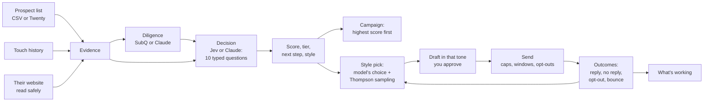

# The decision engine

Cold outreach works when it reaches the right people, at the right moment,
about something they need, in words they answer. The decision engine does that
work for every prospect on a list, before anything is written:

1. **Diligence**: read the prospect's own website (and, with Claude, recent
   news, reviews and job posts) and write down what they need, with the words
   on their pages that show it.
2. **Decide**: ask a decision model ten typed questions about them: do they
   fit, do they need it, why now, can this person say yes, can they pay, and
   which tone, opening, channel and next step suit them.
3. **Score**: turn the answers into a score from 0 to 100, a tier (A to D) and
   a next step, with the reasons. A call the model isn't sure of goes to you.
4. **Write**: personalize the due message in the tone and opening picked for
   that person, around the need diligence found. You approve it, as before.
5. **Learn**: when replies come in, or don't, learn which tones and openings
   get answered by which kinds of prospect, and pick better next time.

Nothing in the engine contacts anyone. It ranks, explains and drafts; the caps,
sending windows, opt-outs and your approval still decide what goes out.



## Who does what

| Stage | With its key | Without it |
| --- | --- | --- |
| Diligence | **SubQ** (Subquadratic's long-context model, `SUBQ_API_KEY`): every page COLD read, whole, in one pass | **Claude** (`ANTHROPIC_API_KEY`): the pages, shortened, plus a few web searches of its own |
| Decide | **Jev** (TypeSafe's System One decision model, `TYPESAFE_API_KEY`): calibrated probabilities for typed questions | **Claude**: the same questions with structured output, a reason for each answer |
| Write | **Claude** | |

Each part is behind a small interface (`DecisionProvider`, `LongReader`), so
another decision model or reader is one adapter: `src/domains/decide/jev.ts`
and `subq.ts` are about a hundred lines each.

Add the keys under **Settings, Connections**. The Score tab shows who is
deciding and reading, and has **Test Jev** and **Test SubQ** buttons. To pin a
choice, add to cold.yaml:

```yaml
decide:
  provider: auto      # auto (Jev when TYPESAFE_API_KEY is set, else Claude), jev, or claude
  diligence: auto     # auto (SubQ when SUBQ_API_KEY is set, else Claude), subq, or claude
  review_below: 0.75  # a next step less sure than this goes to you to check
  explore: true       # now and then try another tone or opening, to learn what works
```

Optional settings for gateways and pinned models: `TYPESAFE_BASE_URL`
(default `https://api.typesafe.ai/v1`), `JEV_MODEL` (default `jev-latest`),
`SUBQ_BASE_URL` (default `https://api.subq.ai/v1`), `SUBQ_MODEL` (default
`subq-preview`). SubQ is in early access; ask Subquadratic for a key and the
current model name.

## Diligence

COLD reads the prospect's website itself: the home page and up to five more
worth reading (about, team, services, jobs, news, reviews, pricing), ranked
from the home page's links. The website comes from the list's `website`
column, or from a business email's domain (never a free mailbox's).

It reads safely, because a list could point anywhere:

- only `http` and `https`, on the normal ports, with no login in the address;
- every address a name resolves to must be on the public internet: private,
  loopback, link-local, carrier and reserved ranges are refused, in every
  spelling (decimal, hex, IPv4 inside IPv6), and each redirect is checked
  again;
- `robots.txt` is honoured, for COLD's own name (`COLD-research`) or `*`;
- every page has a time limit and a size limit, and only web pages are read.

The diligence comes back as a dossier: a summary, what they offer, **needs**
(each with a quote and its source), recent events, the tools they use, the
people who decide, size, how they write about themselves, risks, and what to
ask on a first call.

Every claim is checked against what was read. A need, event or person whose
source was never opened is dropped. A need's quote is looked for on the page
it names: found, it is marked **Quote checked**; not found (the model
paraphrased, or worse), it stays but is marked **Quote not found**, and the
decision model is told so.

## Scoring a whole list

**Score the N not scored** (and **Read their sites first**, for a deep run)
starts a job on the server, so a list of hundreds is scored without keeping
the page open:

- it works through the list a few prospects at a time, and saves each one as
  it finishes; the Score tab shows how far it has got and the last results,
  and the table fills in as scores land;
- on Vercel the request that starts it begins the work, and the cron job
  carries it on every minute; on your computer the app's timer does. Each
  job is held by one runner at a time, and a runner that stops part-way is
  taken over once its hold runs out;
- a prospect that fails is tried again, up to three times, then marked failed
  with the reason; someone who asked not to be contacted is left out before
  the job starts;
- a reason every prospect would hit (no key for any provider) ends the job
  with that reason instead of failing each one;
- **Stop** lets the prospects in hand finish and starts no more. One job per
  list and offer at a time, up to 500 prospects each.

## The decision

The decision model reads one state and answers ten typed questions about it.
The state is JSON: the seller's offer, what the list says (without email
addresses, phone numbers or record ids: a decision doesn't need them, so they
aren't sent), how they can be reached, the dossier or research, and the
history with them.

| Question | Type | What it is for |
| --- | --- | --- |
| fit | yes/no | Is this the kind of business the offer is for? |
| need | yes/no | Does the evidence show the problem or the goal? |
| timing | yes/no | Is there a reason to reach out now? |
| authority | yes/no | Can the person on the list say yes? |
| budget | score, 4 levels | Can they pay for it? |
| tone | choice | Formal, professional, conversational or casual |
| angle | choice | Open with their problem, the result, proof, what just happened, or a question (proof only when you have some; the event only when one is known) |
| objection | choice | What would most likely stop them |
| action | choice | Reach out now, later, research first, or skip |
| channel | choice | Email, LinkedIn, Instagram, X, Facebook or phone, among the ones they can be reached on (only asked when there is more than one) |

With Jev, these go to TypeSafe's System One API as they are: `noul`, `choice`
and `score` questions with `instructions` and `criteria`, and the answers come
back as probabilities with a confidence. With Claude, the same questions go out
with structured output, and its probabilities are turned into the same shape.

### The score

```
score = 100 × fit × (40% need + 20% timing + 15% decision-maker + 10% can pay + 15% reachable)
```

Fit multiplies everything, so a business outside the audience scores low
however busy it is. Reachable is not a model's guess: an email that hasn't
bounced counts fully, a social profile 70%, a phone 50%, nothing 0. Tiers:
**A** 70 and up, **B** 50, **C** 30, **D** below.

The score ranks a list; it is not a promise that anyone will buy. **Do higher
scores reply more?** on the Stats page shows, from your own results, whether
it ranks well.

### The next step, and when you check

The model suggests the next step; these rules overrule it: someone who opted
out (by email, or "do not call" in the dialer) is always **skip**, no way to
reach them is always **research first**, a fit under 25% is always **skip**,
and someone who said "not interested" on a call in the last 90 days is
**later**, never reach out now. A call goes to you to **check** when the
model is less sure than `review_below` (75%, the threshold TypeSafe
recommends for Jev), when the score and the step disagree, when it says skip
someone the dialer logged as interested, or when only the list was known
about them.

The dialer's calls are part of what the model reads: each one in the history
with its outcome, the dialer's AI score and tone, and its summary. A wrong or
bad number stops counting the phone as a way to reach them, which lowers
their reach score.

Anyone marked Do Not Contact, or who ever opted out, is never researched or
scored.

## Writing it

**Personalize with AI** on a campaign's due message now writes in a style:

- **yours**, when you pick a tone or opening;
- else the **decision model's pick** for that person, most of the time;
- now and then **something else**, to learn from (see below);
- with no decision yet, a professional tone, or once their segment has thirty
  results, what has worked there.

The writer gets the tone's and the opening's guide, the needs diligence
confirmed (most important first), and the likely objection, to answer in one
short clause if it fits. It keeps the message's purpose, offer, ask, voice and
length, and still uses only true facts. The draft says which style it used
and why. As before, only an approved draft goes out instead of the template.

A campaign can send **highest score first** (Edit, **Who goes first**): when
the daily cap can't reach everyone due, today's sends go to the most
promising, and anyone not scored follows in list order.

## Learning

Every AI draft records its style and who picked it. Once approved and sent, its
outcome is worked out from the touch log and reply triage:

| Outcome | Counts as |
| --- | --- |
| A reply (interested, a question, not now, or not triaged) | a win |
| Not interested, an opt-out, or no reply in 14 days | a loss |
| A bounce, a failed send, the wrong person | not counted: it says nothing about the style |

A reply to a later step belongs to that step; this step's window closes when
the next one goes out.

Styles are picked with **Thompson sampling**, using the decision model's
opinion as the prior. For each tone (and, separately, each opening), the prior
starts at your overall reply rate, tilted by how strongly the model prefers it
for this person, and is worth twenty messages. Results in the prospect's
**segment** (the same offer, channel and kind of role: owner, manager, staff)
are added to it. One draw per option, and the highest draw is used. So the
model's pick wins most of the time, the others get tried now and then, and as
replies come in they decide. Turn `explore` off to always use the model's pick.

**Stats, What's working** shows the reply rate of each tone and opening, the
range the true rate is likely in (90%), the chance each one is the best,
whether following the model beat trying something else, and whether higher
tiers reply more. With few results the ranges are wide; that is the honest
answer.

## Data and privacy

- What goes where: diligence sends the offer, the list row, the history and
  the pages read to SubQ or Claude. A decision sends the state described above
  (no contact details) to Jev or Claude. Drafts go to Claude, as before.
- Every AI call is kept as a run (`ai_runs`) with its provider, model and
  tokens, so usage can be read per provider.
- Pages are read the way a person would read them, a few per prospect, and
  only where robots.txt allows.
- Opt-outs and Do Not Contact are respected before anything is read.

## The API

All behind the login. Runs start in the background and are followed with
`GET /api/ai/runs/:id`, like the other AI features.

| Route | Does |
| --- | --- |
| `GET /api/decide/status` | Who decides and reads, keys present, counts, usage by provider |
| `POST /api/decide/test` | `{ provider: "jev" \| "subq" }`: a one-question check of the connection |
| `POST /api/decide/diligence` | `{ source, prospect, offer? }`: read their site, write the dossier |
| `POST /api/decide/score` | `{ source, prospect, offer?, account? }`: decide and save |
| `GET /api/decide/scores?source=&offer=` | The latest decision for everyone on a list |
| `GET /api/decide/prospect?prospect=&offer=` | One decision in full, with the dossier |
| `GET /api/decide/insights?refresh=1` | What's working (works out new outcomes first) |
| `POST /api/decide/jobs` | `{ source, offer?, account?, deep?, which?: "unscored" \| "all" }`: score a whole list on the server |
| `GET /api/decide/jobs?source=&offer=` | The latest jobs for a list and offer |
| `GET /api/decide/jobs/:id` | One job: status, counts, the last results |
| `POST /api/decide/jobs/:id/stop` | Stop a job after the prospects in hand |
| `POST /api/ai/draft` | Now takes `tone` and `angle`, and answers with the style used and why |

## Where the code is

| Path | What |
| --- | --- |
| `src/domains/decide/types.ts` | Typed questions and answers, `DecisionProvider` |
| `src/domains/decide/jev.ts` | Jev: TypeSafe's System One API |
| `src/domains/decide/claude.ts` | Claude answering the same questions |
| `src/domains/decide/subq.ts` | SubQ, OpenAI-compatible chat; JSON from text |
| `src/domains/decide/pages.ts` | The safe website reader |
| `src/domains/decide/diligence.ts` | Dossiers, and the source and quote checks |
| `src/domains/decide/model.ts` | The questions, the state, the score and the rules |
| `src/domains/decide/learn.ts` | Outcomes, Thompson sampling, What's working |
| `src/domains/decide/store.ts` | Decisions and style assignments in the database |
| `src/domains/ai/style.ts` | The tone and opening guides the writer follows |
| `src/domains/web/decide/` | The routes, the style pick for drafts, and scoring jobs (`jobs.ts`) |
| `src/web/pages/score.tsx` | The Score tab |

## Selling it to other businesses

COLD runs today as one business's app: one login, one database. To sell the
engine to other businesses, these are the pieces to build, in order. Each
builds on what is here.

### 1. Workspaces

- **A control plane** (its own small database): workspaces, members,
  invitations, roles (owner, admin, member, viewer), sessions, and which
  database belongs to which workspace.
- **A database per workspace**, on Turso. The app already keeps everything a
  workspace owns in one database: files, the touch log, sends, AI runs,
  decisions, what it learned, saved keys. So a workspace is a database, and
  the request handler picks it from the signed-in member's workspace. Turso
  makes a database per customer cheap, isolation is strong (one customer's
  data can't leak into another's queries), and deleting a customer is
  dropping a database.
- **Keys per workspace**: saved keys are already encrypted; give each
  workspace its own data key, wrapped by a master key held outside the
  database (Vercel's KMS or another).
- **Members instead of one owner**: the login becomes email and password (or
  Google) per member, with the same rate limits and session rules.

### 2. Plans, billing and metering

- **Stripe** subscriptions, with usage on top.
- **Meter what costs money**: every AI run already records its provider and
  tokens (`ai_runs`), so prospects scored, sites read and tokens per
  workspace per month are one query. Enforce each plan's limits where runs
  start.
- **Platform keys or their own**: workspaces use COLD's keys for Jev, SubQ
  and Claude by default (billed by usage), or bring their own.
- Packaging that fits how the work is done: seats, mailboxes, and prospects
  scored per month. Agencies get several client workspaces under one bill.

### 3. Work at the size of a real list

- **Scoring on the server**: done (see Scoring a whole list). Next, bigger
  jobs than 500, and a fair share between workspaces when there are several.
- **Re-score on events**: a new trigger, a reply, a bounce, or a month passing.
- **CRM sync** both ways: Twenty is built in; HubSpot and Pipedrive next.
  Scores, tiers and needs written back as fields.
- **Webhooks**, so a customer's own tools can react to a new A-tier prospect.

### 4. Learning across customers

- Today each workspace learns from its own replies. With customers' consent,
  pool **aggregate** results by industry, role and channel (never message text
  or contact details) to give a new workspace a better starting prior.
- **Refit the score's weights** from outcomes once there is enough data (a
  logistic regression on the six factors), and show the calibration.
- Learn the **segments** themselves (industry, size) instead of fixing them.

### 5. Trust and compliance

- A **data processing agreement** and a subprocessor list (Anthropic,
  TypeSafe, Subquadratic, Vercel, Turso).
- **Retention settings** per workspace, deletion on request, and an audit log
  of who scored, approved and sent what.
- Per-workspace **compliance settings** for CAN-SPAM, GDPR and CASL: lawful
  basis, the postal address, opt-out handling across every channel. COLD's
  existing rules (caps, windows, one-click unsubscribe, suppression across
  channels) carry over unchanged.
- A path to SOC 2 once there are customers who ask for it.

### What to say, and not say

The pitch is the work it does: it reads each prospect, ranks the list, and
writes to each person in the way they're most likely to answer, then learns
from the replies. Results claims come only from customers' real numbers, with
their permission; until then, the honest proof is the Stats page of a
customer's own workspace.
